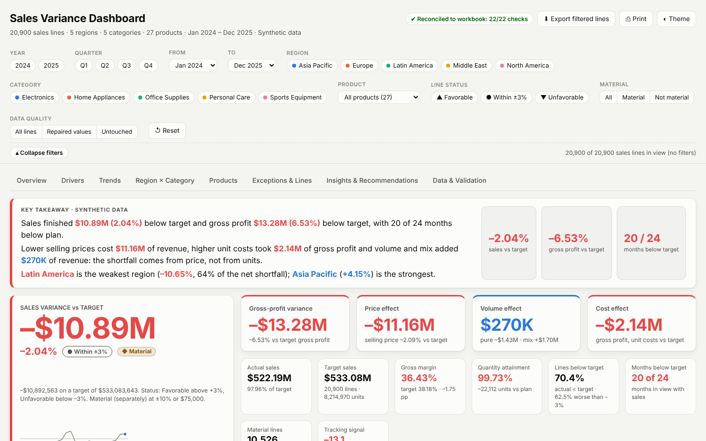
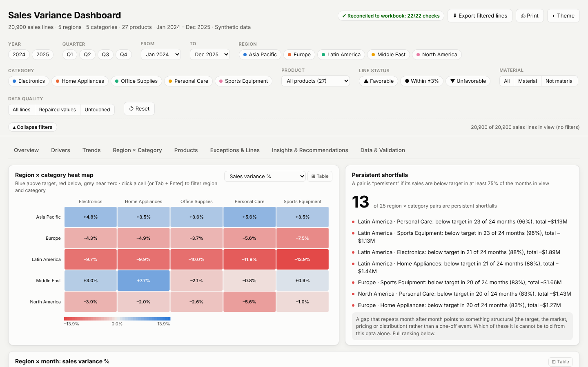

# Sales Variance FP&A Dashboard

End-to-end **sales performance, target tracking and variance analysis** for a global distribution company: from a messy raw Excel file to a cleaned dataset, a validated Excel analysis workbook, a written insights document, and a single-file **interactive HTML dashboard** that works offline.



## Business problem

Finance leadership needs to know **where and why actual sales missed target** across 5 regions, 5 product categories and 27 products over 24 months (Jan 2024 – Dec 2025), and what to do about it.

The raw sales file is messy: 22 different spellings of region names, blank and negative quantities, duplicate rows, inconsistent product spellings. It has to be cleaned and audited before any variance number can be trusted. The project answers four questions:

1. How big is the miss, and is it getting better or worse?
2. Which regions, categories and products drive it?
3. Is it a **price**, **volume** or **mix** problem?
4. Is the miss random, or systematic (a target-setting problem)?

## Key findings

| | |
|---|---|
| **Overall** | Actual **$478.75M** vs target **$488.21M**: variance **–$9.47M (–1.94%)**, quantity attainment 98.03% |
| **Regions** | **Asia Pacific beats target (+$4.48M, +4.57%)**. **Latin America misses by –$7.02M (–7.26%)**, which is **74% of the net shortfall** on about 20% of the target |
| **Categories** | Electronics is the only category above target (+0.89%), and only because of Asia Pacific. Home Appliances has the largest dollar gap (–$2.87M, –2.64%) |
| **Driver** | **100% volume**: the price effect is $0 because actual unit prices equal the plan on every line |
| **Persistence** | **All 24 months** finished below target (tracking signal –24); **17 of 25** region × category pairs miss in at least 75% of months |
| **Products** | Only **6 of 27** products beat target (all Electronics) |
| **Largest gap** | Latin America × Home Appliances: –$1.78M (–8.51%) |

Full write-up with five prioritized recommendations: [`docs/Insights_and_Recommendations.md`](docs/Insights_and_Recommendations.md).

## Interactive dashboard

`dashboard/Sales_Variance_Dashboard.html` is one self-contained file (about 2.4 MB). **Download it and double-click to open it in any browser. It needs no internet connection, server or install.**



What is inside:

- **8 tabs:** Overview, Drivers (price / volume / mix bridge and a what-if simulator), Trends, Region × Category, Products, Exceptions & Lines, Insights & Recommendations, Data & Validation.
- **Key Takeaway banner** and KPI cards that follow your filters.
- **Working slicers:** year, quarter, month range, region, category, product, line status, material flag and data quality. Clicking any bar, month, heat-map cell or table row also filters the whole dashboard.
- **Heat maps, waterfall bridges, Pareto, bubble chart and a line-level explorer**, each with a table view and CSV export.
- **Exact arithmetic:** every figure is computed in the browser from the 25,920 sales lines in integer cents, then **reconciled against the Excel workbook** when the page loads (18 checks, shown as a badge).
- Light and dark mode, print-friendly.

To rebuild it, see [How to run](#how-to-run).

> **Online link (optional):** after pushing, you can serve the dashboard with GitHub Pages (repository *Settings → Pages → Deploy from a branch → `main` / root*). It is then available at `https://kunalkanjwani08-afk.github.io/sales-variance-fpa-dashboard/dashboard/Sales_Variance_Dashboard.html`.

## Tools used

| Area | Tools |
|---|---|
| Data cleaning and analysis | Python 3, pandas, NumPy |
| Excel outputs | openpyxl, XlsxWriter (multi-sheet workbooks with validation sheets) |
| Notebooks | Jupyter, matplotlib |
| Dashboard | HTML, CSS and vanilla JavaScript with hand-built SVG charts (no external libraries, no internet) |
| Method | FP&A variance analysis, price-volume-mix decomposition, materiality thresholds, tracking signal, Pareto analysis |

## Project structure

```
sales-variance-fpa-dashboard/
├── README.md
├── requirements.txt
├── .gitignore
├── data/
│   ├── raw/                  sales_raw_messy_csv.xlsx            (messy source file)
│   └── processed/            Cleaned_Sales_Data.csv / .xlsx      (output of cleaning)
│                             Sales_Variance_Enriched_Data.csv    (cleaned data + variance columns)
├── scripts/
│   ├── clean_sales_data.py             raw -> cleaned data (with audit trail)
│   └── sales_variance_analysis.py      cleaned data -> variance metrics and Excel workbook
├── notebooks/
│   ├── 01_generate_messy_data.ipynb    profile of the raw file (why cleaning is needed)
│   ├── 02_data_cleaning.ipynb          before / after checks on the cleaning
│   └── 03_metrics_and_analysis.ipynb   headline metrics, cross-checked against the workbook
├── docs/
│   ├── Insights_and_Recommendations.md
│   └── images/                         dashboard screenshots used in this README
├── dashboard/
│   ├── build_variance_dashboard.py     builds the HTML dashboard
│   └── Sales_Variance_Dashboard.html   the interactive dashboard (ready to open)
└── outputs/
    └── Sales_Variance_Analysis.xlsx    analysis workbook (19 sheets)
```

## How to run

**Requirements:** Python 3.10 or newer (recommended).

```bash
# 1. Get the project
git clone https://github.com/kunalkanjwani08-afk/sales-variance-fpa-dashboard.git
cd sales-variance-fpa-dashboard

# 2. Install the libraries
pip install -r requirements.txt
```

**To just look at the result:** open `dashboard/Sales_Variance_Dashboard.html` in your browser. Nothing to run.

**To reproduce everything from the raw file**, run these from the repository root, in order (on Windows use `python` or `py`):

```bash
python scripts/clean_sales_data.py              # data/raw  ->  data/processed/Cleaned_Sales_Data.csv + .xlsx
python scripts/sales_variance_analysis.py       # ->  data/processed/Sales_Variance_Enriched_Data.csv + outputs/Sales_Variance_Analysis.xlsx
python dashboard/build_variance_dashboard.py    # ->  dashboard/Sales_Variance_Dashboard.html
```

Each script finds its input automatically and prints a validation summary. The cleaning script reports 44 checks, the analysis script 45 passes and 6 warnings (the warnings are findings about the data, explained below), and the dashboard builder 5 build checks. Running from inside a sub-folder also works.

The notebooks read the files above, so run the three scripts first. Then start Jupyter (`jupyter notebook`) and open the files in `notebooks/`.

## Data note

The dataset is **synthetic** and was built for this portfolio project. That shows in the results: the price effect is exactly $0, Asia Pacific beats target in every month while the other four regions miss in every month, and the gap barely changes between years. A real dataset would be noisier and would show price and mix effects. The value of the project is the method: cleaning, exact variance arithmetic, validation and a decision-ready dashboard. The causes named in the insights document are hypotheses, not findings: the data has no market, competitor or cost-inflation information.

## Author

**Kunal Kanjwani** · [github.com/kunalkanjwani08-afk](https://github.com/kunalkanjwani08-afk)
