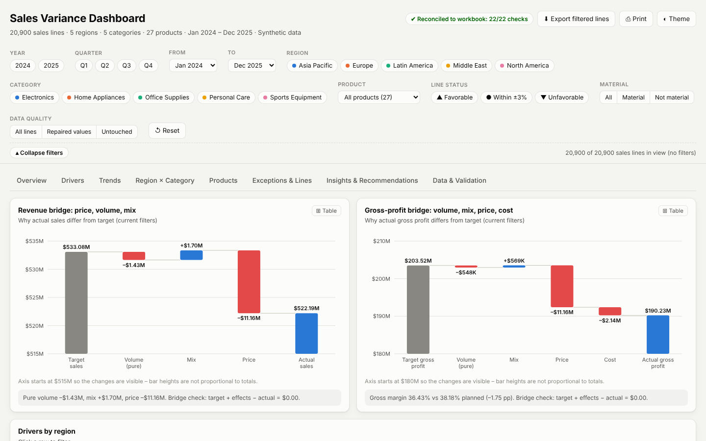

# Sales Variance FP&A Dashboard

End-to-end **FP&A sales variance analysis**: a messy raw sales file is cleaned with a full audit trail, actual sales and gross profit are reconciled to target with exact **price / volume / mix / cost bridges**, and the results are delivered as a validated Excel workbook, a written insights report and a single-file **interactive dashboard that works offline**.

> **Synthetic data.** The business, its targets and the messy raw file are generated by `scripts/generate_synthetic_data.py` with a fixed seed, so every number here can be reproduced exactly. The data imitates real patterns (promotions, price pass-through, cost inflation, a stock-out, new accounts without a target), but it is not a real company. The value of the project is the method: audited cleaning, exact variance arithmetic, independent validation and a decision-ready dashboard.


## Business questions

Finance leadership needs to know **where and why actual results missed target** across 5 regions, 5 product categories and 27 products over 24 months (January 2024 to December 2025):

1. How big is the miss in sales and in gross profit, and is it getting better or worse?
2. Is it a **volume**, **mix**, **price** or **cost** problem?
3. Which regions, categories and products drive it, and is the miss persistent?
4. Were the targets themselves realistic?

## Key results

<!-- KEY-RESULTS:START -->
*Generated by `scripts/build_insights.py` from the current outputs. Synthetic data.*

| | |
|---|---|
| **Sales** | $522.19M vs $533.08M target: **–$10.9M (–2.04%)** |
| **Gross profit** | $190.23M vs $203.52M: **–$13.3M (–6.53%)**; margin 38.18% → 36.43% |
| **Revenue bridge** | pure volume –$1.4M · mix +$1.7M · **price –$11.2M** |
| **Profit bridge** | volume + mix +$21K · price –$11.2M · **cost –$2.1M** |
| **Discounts** | lines sold 5%+ below target price: reached 112.11% of planned units, but gross profit was –16.04% vs target |
| **Regions** | Latin America –10.65% (64% of the net shortfall) · Asia Pacific +4.15% |
| **Consistency** | 20 of 24 months below target · 13 of 25 region × category pairs persistently short · 6 of 27 products above target |
| **Data** | 21,815 raw rows → 20,900 clean sales lines; 4,672 values repaired exactly, 113 rows held for review (nothing estimated) |
<!-- KEY-RESULTS:END -->

Full write-up with five prioritised recommendations: [`docs/Insights_and_Recommendations.md`](docs/Insights_and_Recommendations.md). Every figure in it, and in the table above, is produced by `scripts/build_insights.py` from the analysis outputs. Nothing is typed by hand.

## What is in the project

| Step | Script | Output |
|---|---|---|
| 1. Generate | `scripts/generate_synthetic_data.py` | `data/raw/sales_raw_messy.xlsx` (messy source) and `injected_defects.csv` (answer key, used only by the tests) |
| 2. Clean | `scripts/clean_sales_data.py` | `data/processed/Cleaned_Sales_Data.csv` and `.xlsx` (with reconciliation, cleaning log, corrections audit and review sheets) |
| 3. Analyse | `scripts/sales_variance_analysis.py` | `data/processed/Sales_Variance_Enriched_Data.csv`, `outputs/Sales_Variance_Analysis.xlsx` (20 sheets, including a validation summary) |
| 4. Report | `scripts/build_insights.py` | `docs/Insights_and_Recommendations.md`, `docs/key_metrics.json`, the results table in this README |
| 5. Dashboard | `dashboard/build_variance_dashboard.py` | `dashboard/Sales_Variance_Dashboard.html` (one file, no internet needed) |

Shared logic lives in `fpa_lib/` (`finance.py` for money and bridges, `cleaning.py` for parsing and repair rules, `analysis.py` for metrics, `config.py` for paths, thresholds and the product master). Each script only does work when it is run, and each prints its own validation checks and exits with a non-zero code if a check fails.

### Cleaning rules

- **Line_ID is the record key** (for example `LAT-HOM01-202403-004`, read as text so leading zeros survive). It also encodes the region, product and month, so a blank region or date is recovered from it and a label that contradicts it is sent to review.
- **Explicit mapping tables only** (`N. America`, `NAM`, `NA` → North America). An unknown spelling is never guessed. `NA` is treated as North America in the Region column, not as missing.
- **A number is repaired only when it can be solved exactly** from `Sales = Qty × Unit_Price` and `Gross_Profit = Sales − Qty × Unit_Cost`. If more than one correction would fit, or two linked values are missing, the row goes to review. **Nothing is estimated.**
- Repeated Line_IDs are merged when the copies agree and **all copies are quarantined** when they conflict.
- Every changed value is listed with its original value, rule and certainty; every raw row is reconciled (`raw = clean + blank + duplicates + merged + review`).
- Because the data is synthetic, the cleaned file is tested **cell by cell against the ground truth**: zero differences, and the only true lines missing are the planned review cases.

### Variance method

| Effect | Line-level formula |
|---|---|
| Volume | (Actual_Qty − Target_Qty) × Target_Price |
| Price | Actual_Qty × (Actual_Price − Target_Price) |
| Cost (gross profit) | −Actual_Qty × (Actual_Cost − Target_Cost) |
| Pure volume / mix (group) | pure = (Σ Actual_Qty − Σ Target_Qty) × group average target price; mix = volume − pure |

- Money is held in **integer cents**, so every bridge adds back to the variance exactly. Percentages round half away from zero, as Excel does.
- **Status:** Favorable above +3%, Unfavorable below −3%, otherwise **Within tolerance (±3%)**; "No target" when the target is zero. **Material** if |variance| ≥ 10% or ≥ $75,000. These are kept separate, so a large dollar miss inside the ±3% band is still flagged.
- Group percentages are `Σ variance / Σ target`, never an average of line percentages.
- Target quality is tested too: 2025 targets are compared with a naive "same month last year" forecast (WAPE and bias by region).

Details: [`docs/METHODOLOGY.md`](docs/METHODOLOGY.md) · column definitions: [`docs/DATA_DICTIONARY.md`](docs/DATA_DICTIONARY.md).

## Interactive dashboard

`dashboard/Sales_Variance_Dashboard.html` is one self-contained file. **Download it and double-click to open it in any browser.** It needs no internet connection, server or install.



- **8 tabs:** Overview, Drivers (revenue and gross-profit bridges, discount bands, what-if), Trends, Region × Category, Products, Exceptions & Lines, Insights & Recommendations, Data & Validation.
- **Filters** for year, quarter, month range, region, category, product, status, materiality and repaired values. Clicking a bar, month, heat-map cell or table row filters the whole page, and the headline and takeaways update with it.
- Every chart has a **table view and CSV export** (exported text that starts with `=`, `+`, `-` or `@` is escaped so it cannot run as a spreadsheet formula).
- All figures are computed in the browser from the line data in integer cents and **reconciled against the Excel workbook when the page opens** (the badge at the top shows the result).
- Keyboard accessible (chart marks can be reached with Tab and opened with Enter), works on a phone, light and dark mode (follows the system, with a Theme toggle), print-friendly.


## How to run

Requires **Python 3.11 or newer** (tested on 3.11, 3.12 and 3.13).

**Windows (PowerShell)**

```powershell
git clone https://github.com/kunalkanjwani08-afk/sales-variance-fpa-dashboard.git
cd sales-variance-fpa-dashboard
py -3 -m venv .venv
.\.venv\Scripts\Activate.ps1
python -m pip install -r requirements.txt
```

**macOS / Linux**

```bash
git clone https://github.com/kunalkanjwani08-afk/sales-variance-fpa-dashboard.git
cd sales-variance-fpa-dashboard
python3 -m venv .venv && source .venv/bin/activate
python -m pip install -r requirements.txt
```

**Just looking?** Open `dashboard/Sales_Variance_Dashboard.html`. Nothing to run.

**Reproduce everything** (from the repository root, in this order):

```bash
python scripts/generate_synthetic_data.py       # -> data/raw/
python scripts/clean_sales_data.py              # -> data/processed/Cleaned_Sales_Data.csv + .xlsx
python scripts/sales_variance_analysis.py       # -> enriched CSV + outputs/Sales_Variance_Analysis.xlsx
python scripts/build_insights.py                # -> docs/ insights, key_metrics.json, README results table
python dashboard/build_variance_dashboard.py    # -> dashboard/Sales_Variance_Dashboard.html
```

The generator is deterministic (`--seed 20240101` by default), so the outputs match the committed files. The cleaner also accepts your own file: `python scripts/clean_sales_data.py --input path/to/file.xlsx --output-dir some/folder` (`.xlsx`, `.xlsm` or `.csv` with the same columns).

**Notebooks** (`notebooks/`) walk through the raw-data profile, the cleaning results (including the ground-truth check) and the analysis, re-computing the key numbers with plain pandas. Install the extra tools with `python -m pip install -r requirements-dev.txt`, then run `jupyter lab` or open them in VS Code.

## Tests

```bash
python -m pip install -r requirements-dev.txt
ruff check .
pytest -m "not browser"                         # unit tests + the full pipeline in a temporary folder
python -m playwright install chromium           # once, for the dashboard tests
pytest -m browser                               # opens the dashboard in headless Chromium
```

The suite covers the money and rounding rules, the ±3% and materiality boundaries, every parser and repair rule, schema errors (missing columns, empty files, unsupported `.xls`), a full pipeline run checked cell by cell against the ground truth, both workbooks' validation sheets, the generated report numbers, a check that the committed outputs are up to date, and the dashboard itself (no script errors, in-browser reconciliation, filtered totals compared with pandas, keyboard use and no horizontal overflow at phone width). GitHub Actions runs it on Python 3.11, 3.12 and 3.13 for every push and pull request (`.github/workflows/ci.yml`).

## Project structure

```
sales-variance-fpa-dashboard/
├── README.md · LICENSE · requirements.txt · requirements-dev.txt · pyproject.toml
├── .github/workflows/ci.yml          lint + tests on Python 3.11-3.13, dashboard browser test
├── fpa_lib/                          shared logic: finance.py, cleaning.py, analysis.py, config.py
├── scripts/
│   ├── generate_synthetic_data.py    synthetic business + messy raw file + defect answer key
│   ├── clean_sales_data.py           raw -> clean data with audit trail
│   ├── sales_variance_analysis.py    clean data -> variance metrics + Excel workbook
│   └── build_insights.py             outputs -> insights report, key metrics, README results
├── dashboard/
│   ├── build_variance_dashboard.py   bundles template/ + data into one HTML file
│   ├── template/                     page.html and the dashboard JavaScript
│   └── Sales_Variance_Dashboard.html the dashboard (ready to open)
├── data/
│   ├── raw/                          sales_raw_messy.xlsx, injected_defects.csv
│   └── processed/                    Cleaned_Sales_Data.csv/.xlsx, Sales_Variance_Enriched_Data.csv
├── outputs/                          Sales_Variance_Analysis.xlsx
├── notebooks/                        01_raw_data_profile, 02_data_cleaning, 03_metrics_and_analysis
├── docs/                             insights report, key_metrics.json, METHODOLOGY.md, DATA_DICTIONARY.md, images/
└── tests/                            pytest suite
```

## Limitations

- **Synthetic data.** Causes named in the insights report (discounting, a stock-out, cost inflation, phasing) were built into the generator. The method finds them; it does not prove that a real business would behave the same way.
- **No outside data:** no market size, competitor prices, customer-level data or returns, so external causes cannot be tested.
- **Gross profit only:** there is no operating expense, freight or rebate data, so this is not a full P&L bridge.
- **Mix is measured at group level** against the group's average target price. A different grouping (for example product within region) gives a different split of volume and mix, though the total is always the same.
- The dashboard loads the line data into the page (about 21,000 lines). That is fine for this size; a much larger dataset would need a database or a BI tool such as Power BI.

## License and author

MIT License (see [`LICENSE`](LICENSE)). Built by **Kunal Kanjwani** · [github.com/kunalkanjwani08-afk](https://github.com/kunalkanjwani08-afk)
